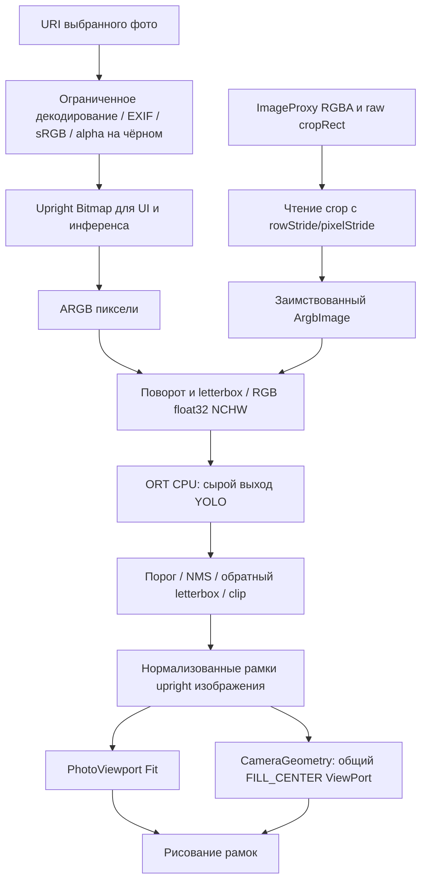

# Изображения, координаты и измерения

Справка для разработчика CV/Android: путь от фото или RGBA-кадра к рамкам. Применяется к Android-пайплайну без трекинга и внешнего получателя координат.

## Общий поток

Рисунок 2. Входные ветви сходятся в одном Kotlin-движке. Для фото поворот равен 0: EXIF уже применён. Для камеры `ImageInfo.rotationDegrees` применяется к raw crop в preprocessing, без повторного поворота рамок.

## Пространства координат

| Этап | Единицы и система отсчёта | Реализация и преобразование |
|---|---|---|
| Фото до decode | Размеры файла и EXIF | [AndroidPhotoBackend](../../app/src/main/java/ru/university/dronecv/photo/AndroidPhotoBackend.kt): ориентация, большая сторона до 2048 px, alpha на чёрном |
| Кадр камеры | RGBA, `cropRect` в raw px | [RgbaFrameConverter](../../app/src/main/java/ru/university/dronecv/camera/RgbaFrameConverter.kt): crop, stride и позиция ByteBuffer → packed ARGB |
| Upright вход | Пиксели повёрнутого изображения | [YoloPreprocessor](../../app/src/main/java/ru/university/dronecv/detection/yolo/YoloPreprocessor.kt): поворот совмещён с выборкой при масштабировании |
| Вход YOLO | Пиксели квадрата модели | [Letterbox](../../app/src/main/java/ru/university/dronecv/detection/yolo/Letterbox.kt): сохранение пропорций и поля; тензоры — [MODEL](../../ml/MODEL.md#3-тензоры) |
| После postprocessing | Пиксели upright изображения | [YoloPostprocessor](../../app/src/main/java/ru/university/dronecv/detection/yolo/YoloPostprocessor.kt): вычесть поля, разделить на scale, обрезать по границам |
| `Detection.box` | Доли ширины/высоты `[0,1]`, начало слева сверху | [DetectionMapping](../../app/src/main/java/ru/university/dronecv/detection/yolo/DetectionMapping.kt) |
| Фото в UI | Экранные px с полями Fit | [PhotoViewport](../../app/src/main/java/ru/university/dronecv/photo/PhotoGeometry.kt): один прямоугольник для bitmap и рамок, без независимого округления |
| Камера в UI | Экранные px PreviewView | [CameraGeometry](../../app/src/main/java/ru/university/dronecv/camera/CameraGeometry.kt): умножение на размеры view при общем ViewPort Preview/Analysis |

Не заменяйте camera mapping независимым `Fit`: PreviewView использует `FILL_CENTER`. Layout/display rotation требуют нового ViewPort и инвалидирования старых результатов. Камера задняя, без зеркального отображения.

## Границы измерений

В [YoloOnnxEngine](../../app/src/main/java/ru/university/dronecv/detection/onnx/YoloOnnxEngine.kt) `preprocessMs` охватывает preprocessing, `inferenceMs` — `runModel()`, включая запись/создание входного тензора и чтение выхода, `postprocessMs` — decode/NMS. Фото показывает `inferenceMs`, без декодирования и создания движка.

В [AndroidLiveBackend](../../app/src/main/java/ru/university/dronecv/camera/AndroidLiveBackend.kt) `conversionMs` измеряет RGBA crop → ARGB. [LiveController](../../app/src/main/java/ru/university/dronecv/camera/LiveController.kt) измеряет `pipelineMs` вокруг `backend.infer()`: возможны ленивая загрузка модели и служебные расходы. Сумма стадий не обязана равняться pipeline.

Интервалы вычисляются по `System.nanoTime()`. `started_epoch_ms` задаёт внешнюю дату начала, а не базу длительностей. Ожидание до analyzer, экспозиция и дисплей не входят в pipeline. End-to-end задержка и число пропущенных CameraX кадров не измеряются.

Текущий FPS экрана вычисляется по завершениям в окне до 30 результатов, ограниченном примерно 3 с с сохранением минимум двух результатов; после первого кадра он неизвестен. `processed_fps_session` делит успешные кадры на всю длительность диагностической сессии, включая простои. Ни одно значение не является FPS камеры/дисплея. Поля экспорта — [модель данных](../reference/data-model.md).

## Проверка и ограничения

Повороты, crop/stride, каналы, letterbox и mapping покрывают JVM-тесты; [реальный ORT](../../app/src/test/java/ru/university/dronecv/detection/OnnxParityTest.kt) проверяется отдельно. Parity с Python требует fixtures. Совмещение рамок на физическом сенсоре проверяется по [CAMERA_QA](../CAMERA_QA.md) и [LIVE_QA](../LIVE_QA.md).

Рамка относится к прошлому обработанному кадру и может отставать при движении. Размеры объекта на мониторе, в кадре и на входе YOLO различаются; лабораторные преобразования заданы в [протоколе](../../lab/monitor_test/PROTOCOL.md#5-размеры-и-экспорт).
