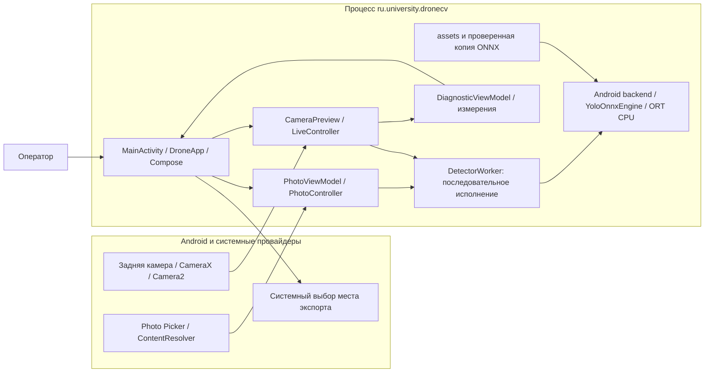

# Архитектура приложения

Описание для разработчика и рецензента Android-приложения базы `acb3e9e`. Планы ВКР не считаются реализованными возможностями.

## Контекст и границы

Оператор выбирает фото либо наблюдает заднюю камеру. Приложение выполняет локальный инференс одного класса `drone`, рисует рамки и позволяет исследовать время обработки и камеры. Единственная Activity использует Jetpack Compose; Gradle-модуль один — `:app`. DI-контейнера, сетевого сервиса и отдельных слоёв repository/use-case нет.

Рисунок 1. Контекст и компоненты одного процесса. Стрелки показывают обращения/передачу данных; worker задаёт порядок работы, а не отдельный сервис. Экспорт получает выбранный пользователем провайдер. Python-инструменты и галерея работают отдельно на компьютере и не входят в APK.

## Ответственность компонентов

| Компонент | Реализация | Ответственность |
|---|---|---|
| Вход и режимы | [MainActivity](../../app/src/main/java/ru/university/dronecv/MainActivity.kt), [DroneApp](../../app/src/main/java/ru/university/dronecv/DroneApp.kt) | Edge-to-edge, тема, вкладки, сохранение порога и числа потоков через `rememberSaveable` |
| Фото | [PhotoViewModel](../../app/src/main/java/ru/university/dronecv/photo/PhotoViewModel.kt), [PhotoController](../../app/src/main/java/ru/university/dronecv/photo/PhotoController.kt), [AndroidPhotoBackend](../../app/src/main/java/ru/university/dronecv/photo/AndroidPhotoBackend.kt) | Activity-владение, decode/EXIF, очередь команд и отбрасывание устаревших ответов |
| Камера и разрешение | [CameraScreen](../../app/src/main/java/ru/university/dronecv/camera/CameraScreen.kt), [CameraPreview](../../app/src/main/java/ru/university/dronecv/camera/CameraPreview.kt) | Разрешение, lifecycle, общий ViewPort, bind/unbind Preview и ImageAnalysis, ошибки камеры |
| Анализ кадров | [LiveController](../../app/src/main/java/ru/university/dronecv/camera/LiveController.kt), [AndroidLiveBackend](../../app/src/main/java/ru/university/dronecv/camera/AndroidLiveBackend.kt) | Синхронный analyzer, закрытие кадров, нормализованные результаты и измерения |
| Общий исполнитель | [DetectorWorker](../../app/src/main/java/ru/university/dronecv/detection/DetectorWorker.kt) | Один executor/dispatcher на процесс; нативный инференс фото/камеры не выполняется параллельно |
| Детектор | [OnnxDroneDetector](../../app/src/main/java/ru/university/dronecv/detection/onnx/OnnxDroneDetector.kt), [YoloOnnxEngine](../../app/src/main/java/ru/university/dronecv/detection/onnx/YoloOnnxEngine.kt) | Android-адаптер, общий JVM/Android ORT-движок, валидация тензоров, сессия |
| Чистые алгоритмы | [detection/yolo](../../app/src/main/java/ru/university/dronecv/detection/yolo) | Поворот, letterbox, RGB-тензор, декодирование и NMS без Android SDK |
| Диагностика | [diagnostics](../../app/src/main/java/ru/university/dronecv/diagnostics) | Измерения кадров/ресурсов, статистика, последний отчёт в Activity ViewModel, экспорт |
| Камеры и зум | [CameraInventory](../../app/src/main/java/ru/university/dronecv/camera/CameraInventory.kt), [CameraProbeState](../../app/src/main/java/ru/university/dronecv/camera/CameraProbeState.kt) | Метаданные Camera2/CameraX, запрос зума/физического ID и состояние rebind |

Инварианты потоков и ресурсов описаны в [жизненном цикле](../internals/detection-lifecycle.md), координаты — в [потоках данных](data-flow.md), параметры — в [конфигурации](../reference/configuration.md).

## Хранение и доверие

Изображение от провайдера и буфер камеры — входные данные. Размер декодирования фото ограничивается, параметры RGBA проверяются. Эти меры не доказывают полную безопасность обработки произвольных файлов.

ONNX из assets проверяется по SHA-256 и устанавливается атомарно в `noBackupFilesDir/models/`. Это контроль соответствия известному файлу; доверие к источнику и лицензия рассматриваются отдельно. Backend владеет ORT-сессией, общий `OrtEnvironment` живёт в процессе. Фото- и camera-backend могут удерживать разные сессии, хотя исполняют работу последовательно.

В [AndroidManifest](../../app/src/main/AndroidManifest.xml) есть разрешение `CAMERA`, отсутствует `INTERNET`, `allowBackup=false`. Истории фото/рамок нет. JSON диагностики и камер передаются провайдеру только по явному экспорту; провайдер может иметь собственную сетевую синхронизацию. Подробнее — [интеграции](../reference/integrations.md) и [безопасность](../../SECURITY.md).

## Ограничения и проверка

ViewModel сохраняет фото/отчёт при обычном пересоздании Activity, но не после уничтожения процесса. Рамки относятся к последнему обработанному кадру; прогноза и компенсации задержки нет. Камеры и зум зависят от Android/OEM; 5× не подтверждает оптический объектив.

Исторического ADR с подтверждёнными альтернативами и участниками нет. Документ фиксирует устройство кода, не приписывая команде незафиксированные причины выбора. Проверяйте схему по таблице исходников и тестам из [карты кода](../development/codebase.md).
