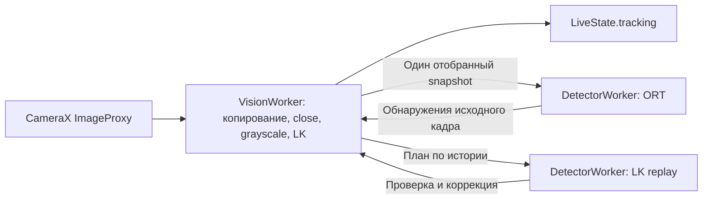

# Вход камеры отдельно от инференса

Для разработчика Android. Камера копирует и закрывает вход независимо от длительной работы YOLO. [Сопровождение](visual-tracking-core.md) подключено на VisionWorker.

## Исполнители и очередь



LiveFrameCapture получает generation/source/diagnostic token до копирования и закрывает ImageProxy в finally до передачи snapshot. Камера держит один цикл YOLO/replay/commit; новых снимков для YOLO до его завершения не накапливает. Все вызовы ORT, смена числа потоков и закрытие модели сериализуются общим DetectorWorker. LK не ждёт YOLO. Ветвь без LiveTracking, используемая совместимыми вызовами и тестами, сохраняет заменяемый pending snapshot и epoch pump.

Stop, pause, порог, error и rebind сразу очищают опубликованный результат. Нативный трекер закрывается на VisionWorker; запоздавшая коррекция освобождается владельцем и не публикуется. Закрытие ORT ставится на DetectorWorker, без ожидания из UI.

## Пиксели и память

[CameraFramePool](../../app/src/main/java/ru/university/dronecv/camera/CameraFrameSnapshot.kt) удерживает максимум три ARGB-массива: выполняющийся снимок, входной снимок и резерв под совместимую ветвь с pending. Общий лимит их удерживаемого объёма — 16 MiB; это не лимит всей памяти процесса. Свободные массивы прежнего размера могут освобождаться из пула, leased-массивы не меняются. Возвращать массив можно только после завершения его читателя. Повторный close lease безопасен и не освобождает новое использование того же слота.

При отсутствии свободного слота/бюджета входной кадр закрывается, no_buffer увеличивается, память не расширяется. Если размеры требуют больше одного бюджета, такой кадр тоже пропускается. При production-вызовах copyInto конвертер сохраняет только временную строку; copyInto не удерживает переданный массив. Прежний convert остаётся заимствованным API для синхронного использования.

Snapshot содержит raw crop ARGB и rotationDegrees. YOLO применяет поворот в существующем preprocessing; повторно поворачивать snapshot или рамки нельзя. Нормализованные рамки и пиксельный центр остаются в пространстве upright crop. Общий ViewPort/FILL_CENTER и фиксированный размер панели сохранены.

## Времена и измерения

- Перед копированием отбрасывается подтверждённый возраст экспозиции больше maxAnalyzerAgeMs (250 мс).
- Перед ORT дополнительно проверяются время ожидания снимка в очереди приложения и, при совместимой базе, его текущий возраст от экспозиции. Превышение того же лимита пропускает infer.
- При UNKNOWN камера не позволяет вычислять абсолютный capture age; известное время ожидания в очереди приложения всё равно можно ограничить. Смещение часов не подбирается.
- conversion_ms теперь измеряется при подготовке snapshot на VisionWorker. pipeline_ms равен сумме подготовки и длительности ML-backend; ожидание между workers в него не входит. В сигнале LK analyzer_to_signal_ms включает копирование, закрытие ImageProxy и работу до публикации на VisionWorker. Коррекция помечается отдельно; она не прибавляет ещё один кадр к частоте LK. Остальные границы — [измерение задержки](latency-and-prediction.md).

UI отдельно показывает входной FPS по последним максимум 30 callback, завершения YOLO и обновления LK. Первый относится к принятому входу приложения, не к сенсору. JSON содержит camera_input со счётчиками и FPS всей диагностической сессии; формат — [модель данных](../reference/data-model.md#вход-камеры-в-052).

Diagnostic token фиксируется при приёме кадра. YOLO относится к токену исходного кадра запроса; наблюдение LK и коррекция относятся к токену кадра, на котором публикуется положение. Поэтому коррекция может использовать детекцию кадра до начала записи, если положение перенесено на кадр новой сессии. События после остановки записи не дополняют уже сформированный отчёт. Число superseded/no_buffer относится к приложению; CameraX upstream drops остаются неизвестными.

## Проверка этапа

LiveFrameCaptureTest блокирует поддельный backend и проверяет продолжение приёма/закрытия входов, latest-only замену, последовательный infer, generation/source и diagnostic token. Отдельно проверяются очереди old pump → close → new pump, Stop во время копирования, OOM/ошибка close, устаревшая очередь и rejected executor. CameraFramePoolTest проверяет лимиты, повторный release и сохранность пикселей при следующем копировании.

Локальные команды из корня репозитория с настроенным JDK/SDK:

```bash
./gradlew --no-daemon assembleDebug assembleDebugAndroidTest testDebugUnitTest lintDebug
python3 -m pytest ml/tests/test_analyze_android_sessions.py ml/tests/test_target_signals.py -q
```

assembleDebugAndroidTest только компилирует APK тестов. Эмулятор в CI проверяет сборку и интеграцию; результаты конкретного запуска записываются в PR. JVM-проверки подтверждают управление ресурсами, но не частоту реальной камеры, задержку/нагрев телефона или достижение 20–30 обновлений цели в секунду. Артефакты и результаты конкретной проверки — PROJECT_STATE.
