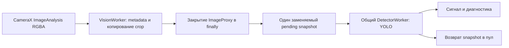

# Вход камеры отдельно от инференса

Для разработчика Android 0.5.2. Этот этап отделяет приём изображений от YOLO и задаёт владение снимками. [Экспериментальное ядро трекинга](visual-tracking-core.md) пока не подключено к этому конвейеру. Координаты обновляются только после очередного YOLO, независимо для каждого отобранного снимка.

## Исполнители и очередь



Рисунок 1. CameraX сохраняет KEEP_ONLY_LATEST. Обработчик входа не ожидает ORT; между исполнителями передаются только собственные пиксели. Единственный ML-worker по-прежнему обслуживает фото, камеру, переключение потоков и закрытие сессии.

[LiveFrameCapture](../../app/src/main/java/ru/university/dronecv/camera/LiveFrameCapture.kt) получает token до копирования, подготавливает snapshot и закрывает исходный кадр перед offerFrame. CameraPreview отвечает за закрытие при ошибке метаданных до передачи адаптеру. После передачи повторно закрывать ImageProxy нельзя. Ошибки копирования/закрытия и OOM инвалидируют только актуальную generation; подготовленный snapshot при ошибке тоже освобождается.

[LiveController](../../app/src/main/java/ru/university/dronecv/camera/LiveController.kt) хранит один pending snapshot. Более свежий заменяет его с немедленным освобождением старого. Выполняющийся infer не прерывается. После каждого infer следующий pump ставится в конец ML-очереди: закрытие сессии и другие уже ожидающие команды не голодают. Устаревший pump не может забрать снимок новой активации: у pump есть отдельный epoch.

Изменение порога, Stop, pause, error и rebind очищают pending и результат. Generation/source защищают как копирование в процессе, так и запоздавший infer/error. Release ставится до наблюдаемой invalidation, поэтому синхронный подписчик StateFlow не запускает новый infer перед закрытием прежней сессии. UI не ожидает native call, общие исполнители живут до завершения процесса.

## Пиксели и память

[CameraFramePool](../../app/src/main/java/ru/university/dronecv/camera/CameraFrameSnapshot.kt) удерживает максимум три ARGB-массива: выполняющийся снимок, pending и новый снимок во время копирования. Общий лимит их удерживаемого объёма — 16 MiB; это не лимит всей памяти процесса. Свободные массивы прежнего размера могут освобождаться из пула, leased-массивы не меняются. Возвращать массив можно только после завершения его читателя. Повторный close lease безопасен и не освобождает новое использование того же слота.

При отсутствии свободного слота/бюджета входной кадр закрывается, no_buffer увеличивается, память не расширяется. Если размеры требуют больше одного бюджета, такой кадр тоже пропускается. При production-вызовах copyInto конвертер сохраняет только временную строку; copyInto не удерживает переданный массив. Прежний convert остаётся заимствованным API для синхронного использования.

Snapshot содержит raw crop ARGB и rotationDegrees. YOLO применяет поворот в существующем preprocessing; повторно поворачивать snapshot или рамки нельзя. Нормализованные рамки и пиксельный центр остаются в пространстве upright crop. Общий ViewPort/FILL_CENTER и фиксированный размер панели сохранены.

## Времена и измерения

- Перед копированием отбрасывается подтверждённый возраст экспозиции больше maxAnalyzerAgeMs (250 мс).
- Перед ORT дополнительно проверяются время ожидания снимка в очереди приложения и, при совместимой базе, его текущий возраст от экспозиции. Превышение того же лимита пропускает infer.
- При UNKNOWN камера не позволяет вычислять абсолютный capture age; известное время ожидания в очереди приложения всё равно можно ограничить. Смещение часов не подбирается.
- conversion_ms теперь измеряется при подготовке snapshot на VisionWorker. pipeline_ms равен сумме подготовки и длительности ML-backend; ожидание между workers в него не входит. analyzer_to_signal_ms включает копирование, закрытие исходного кадра, ожидание и обработку до готовности сигнала. Остальные границы — [измерение задержки](latency-and-prediction.md).

UI показывает отдельно входной FPS по последним максимум 30 callback и FPS завершений YOLO. Первый относится к принятому входу приложения, не к сенсору. JSON содержит camera_input со счётчиками и FPS всей диагностической сессии; формат — [модель данных](../reference/data-model.md#вход-камеры-в-052).

Diagnostic token фиксируется при приёме исходного кадра. Работа старой/завершённой диагностической сессии не записывается в новую. События после остановки записи не дополняют уже сформированный отчёт. Число superseded/no_buffer относится к приложению; CameraX upstream drops остаются неизвестными.

## Проверка этапа

LiveFrameCaptureTest блокирует поддельный backend и проверяет продолжение приёма/закрытия входов, latest-only замену, последовательный infer, generation/source и diagnostic token. Отдельно проверяются очереди old pump → close → new pump, Stop во время копирования, OOM/ошибка close, устаревшая очередь и rejected executor. CameraFramePoolTest проверяет лимиты, повторный release и сохранность пикселей при следующем копировании.

Локальные команды из корня репозитория с настроенным JDK/SDK:

```bash
./gradlew --no-daemon assembleDebug assembleDebugAndroidTest testDebugUnitTest lintDebug
python3 -m pytest ml/tests/test_analyze_android_sessions.py ml/tests/test_target_signals.py -q
```

assembleDebugAndroidTest только компилирует APK тестов. Выполнение на Android/эмуляторе в этом этапе не проводилось. JVM-проверки подтверждают управление ресурсами, но не частоту реальной камеры, задержку/нагрев телефона или достижение 20–30 обновлений цели в секунду. Артефакты и результаты конкретной проверки — PROJECT_STATE.
