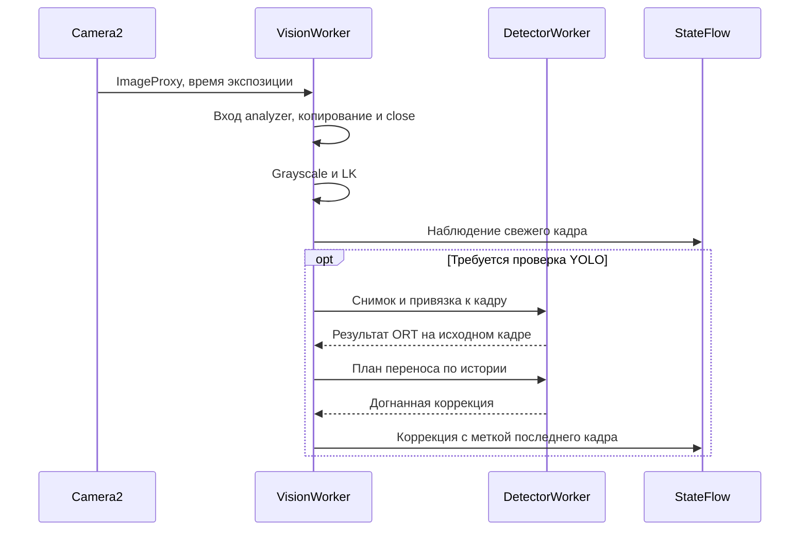

# Задержка от экспозиции до внутреннего сигнала

Инструкция разработчику и тестировщику. В режиме камеры сигнал LK публикуется в `LiveController.state` как `LiveState.tracking`; приложение рисует рамку и центр. Сигнал не подтверждает отправку команды внешнему устройству.

## Часы и границы

| Интервал | Начало | Конец |
|---|---|---|
| Экспозиция → analyzer | Camera2 timestamp изображения | Вход в CameraX analyzer |
| Analyzer → сигнал | Вход в CameraX analyzer | Подготовка публикации в StateFlow |
| Экспозиция → сигнал | Camera2 timestamp изображения | Подготовка публикации в StateFlow |

При Camera2 timestamp source REALTIME часы совместимы с `elapsedRealtimeNanos`. Для UNKNOWN или некорректного порядка меток интервалы от экспозиции равны null, с `timing_issue`. Analyzer → сигнал использует часы приложения и может быть доступен независимо. Длительности этапов и относительное время записи используют `System.nanoTime()`; его не вычитают из Camera2 timestamp.

Конец измерения — чтение часов перед формированием небольшого payload и записью в StateFlow. Ожидание подписчика, перерисовка дисплея и физическое действие в измерение не входят. StateFlow хранит последнее состояние, поэтому медленный подписчик может пропускать промежуточные значения.



Рисунок 1. LK публикует наблюдения без ожидания ORT. Коррекция переносится по изображениям и использует метку кадра, на котором вычислено итоговое положение. [Привязка по времени и владение](visual-tracking-core.md).

## Координаты одного кадра

`center.x/y` — непрерывный центр рамки upright crop; `pixel.x/y` — индексы через отбрасывание дробной части. Размер `width/height` относится к полному crop после поворота. Координаты измеряются от левого верхнего угла и не относятся к полному сенсору или скриншоту. Центр ограничен `[0,W-1] × [0,H-1]`. При потере и поиске рамки и центра нет. Stop/pause/error/rebind/порог сбрасывают сигнал; экран очищает рамку через 250 мс без новой публикации или при истечении подтверждения YOLO, если оно наступает раньше. Таймер относится к ревизии конкретной публикации.

Последний confidence относится к проверке YOLO на исходном кадре. Его возраст считается от экспозиции именно этого кадра, когда база часов совместима. Качество LK описывает движение точек и сходство изображения. `track_id` действует внутри экземпляра контроллера; после повторного поиска он может измениться даже для того же дрона.

## Экспорт и проверка

Приложение экспортирует текущую запись кнопкой «Экспорт NDJSON». Поток содержит внутренние публикации и причины переходов; для восстановления шкалы и интерпретации неполных записей используйте [формат NDJSON](../reference/data-model.md#поток-диагностической-сессии-dronecv-session-timeline-1). Прежние файлы тоже поддерживаются.

В прежнем отчёте корневой schema 1 с публикациями LK есть раздел `tracking` версии 1. `frames[]` и `processed_fps_session` относятся к YOLO. Сводка LK рассчитывает p50/p95 по сохранённым обновлениям с координатами и измеримым временем. Коррекции записываются отдельно и не считаются новыми кадрами. Смотрите [формат и знаменатели](../reference/data-model.md#наблюдения-lk). Анализатор также читает прежние отчёты с `target_signal` v1/v2 и без сигналов.

```bash
python3 ml/scripts/analyze_android_sessions.py /absolute/path/to/session.ndjson --output /tmp/session-analysis.json
python3 -m unittest discover -s ml/tests -p test_tracking_reports.py -v
```

1. После прогрева запишите сессию по [PERFORMANCE_QA](../PERFORMANCE_QA.md). Сверьте частоту входа, YOLO и LK отдельно. Проверьте причины null, доступность времени экспозиции и p50/p95.
2. Повторите Stop/start, фон, поворот, смену камеры/зума и порога. Старые координаты не должны возвращаться.
3. На размеченной движущейся цели проверьте потери, ложное удержание, смены цели, время повторного поиска и нагрев. [Условия проверки](visual-tracking-core.md#проверки-и-испытания).

## Как уменьшать задержку

Сначала разделите ожидание до analyzer и работу приложения. LK публикует положение между вызовами YOLO, но реальный выигрыш и частоту нужно измерить на телефоне. Просроченные кадры пропускаются до ORT; это не ускоряет один вызов. Настройки потоков сравнивайте на одном устройстве по [протоколу](../ORT_THREAD_BENCHMARK.md), сохраняя модель, сцену, порог и размер анализа. Задержку дисплея и пропуски CameraX до callback этот экспорт не измеряет.
