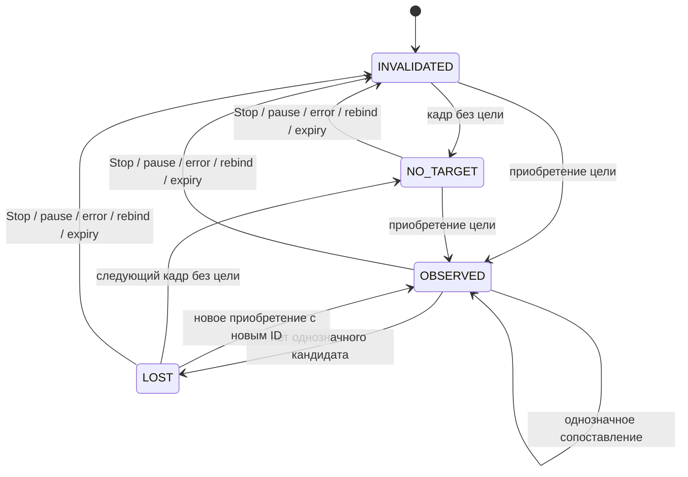

# Задержка, координаты цели и прогноз

Инструкция разработчику и тестировщику Android 0.5.0. Граница сигнала согласована как внутреннее событие приложения и диагностический JSON. Подключения внешнего устройства и подтверждения физического действия нет.

## Что измеряется

CameraX с Camera2 передаёт `ImageInfo.timestamp`. Для этого источника метка соответствует `SENSOR_TIMESTAMP`: началу экспозиции первой строки активной области сенсора, а не входу в analyzer. Это не время экспозиции конкретной строки, в которой находится дрон. Контракт — [CaptureResult.SENSOR_TIMESTAMP](https://developer.android.com/reference/android/hardware/camera2/CaptureResult#SENSOR_TIMESTAMP).

`CameraPreview` проверяет `SENSOR_INFO_TIMESTAMP_SOURCE` выбранной камеры. Только для REALTIME метку разрешено вычитать из `SystemClock.elapsedRealtimeNanos()`. При UNKNOWN камеры могут предоставлять собственную монотонную базу: она пригодна для интервалов между наблюдениями этой камеры, но не для измерения задержки до приложения. Основание — [источник временных меток Camera2](https://developer.android.com/reference/android/hardware/camera2/CameraCharacteristics#SENSOR_INFO_TIMESTAMP_SOURCE).

| Поле сигнала | Определение |
|---|---|
| `capture_ns` | Метка камеры в нс, null при отсутствии |
| `analyzer_entry_ns` | elapsedRealtimeNanos при входе в callback analyzer |
| `signal_dispatch_ns` | Последнее чтение elapsedRealtimeNanos перед построением и синхронной публикацией сигнала |
| `capture_to_signal_ms` | `(signal_dispatch_ns - capture_ns) / 1e6`, только для подтверждённой временной базы |
| `capture_to_analyzer_ms` | Время от экспозиции до callback, включая доставку и ожидание worker |
| `analyzer_to_signal_ms` | Обработка кадра и подготовка результата на worker |

Если метка отсутствует, находится в будущем относительно входа или часы идут назад, задержка от экспозиции равна null; причина — `timing_issue`. Никакая поправка часов из времени первого callback не подбирается. Длительности существующего pipeline сохраняют собственную базу `System.nanoTime`; из неё не вычитаются метки Camera2.

Конец измерения — публикация последнего значения `LiveController.signals: StateFlow<TargetSignal?>`. Чтение часов предшествует сборке небольшого payload и присваиванию StateFlow; затраты этого присваивания отдельно не измерены. Это не задержка до обработки подписчиком, отображения экрана или физического действия. Поток conflated: медленный подписчик может пропустить промежуточные значения. JSON сохраняет сигналы обработанных кадров во время активной диагностической сессии в пределах её capacity.

```mermaid
sequenceDiagram
    participant C as Camera2
    participant A as CameraX analyzer
    participant W as ML-worker
    participant S as StateFlow и диагностика
    C->>A: ImageProxy + timestamp экспозиции
    A->>A: Зафиксировать вход; проверить временную базу и возраст
    alt Известный возраст больше 250 мс
        A->>S: Увеличить application_stale_frames_discarded
        A->>A: Закрыть кадр без ORT
    else Свежий кадр или возраст неизвестен
        A->>W: Синхронный YOLO
        W->>W: Сопоставить цель и оценить скорость
        W->>S: Сигнал с frame/source/target ID и временами
        W->>A: Закрыть ImageProxy в finally
    end
```

Рисунок 1. Путь кадра до внутреннего сигнала. Generation/source проверки перед публикацией отбрасывают устаревшие результаты после Stop, порога, pause и rebind. Дополнительной очереди изображений нет.

До передачи кадра контроллеру CameraPreview закрывает его при ошибке получения/создания метаданных; после передачи кадр закрывается только в finally контроллера. Это исключает удержание ImageProxy при сбое до входа в analyze и повторное закрытие после него.

## Координаты и сопровождение

Реализация — [TargetSignal.kt](../../app/src/main/java/ru/university/dronecv/camera/TargetSignal.kt). Выбирается одна цель класса 0 с наибольшим confidence. Затем кандидаты сопоставляются с ожидаемым положением прежней цели; при близких по оценке кандидатах или выходе из spatial gate цель объявляется потерянной. Следующее приобретение получает новый ID. Это геометрическое сопоставление, не доказательство физической идентичности дрона.

`observed.x/y` — центр последней рамки, в пикселях upright crop; начало слева сверху, оси вправо и вниз. `width/height` — размеры именно этой области после поворота. `observed_pixel.x/y` — целочисленные индексы через отбрасывание дробной части, в пределах `[0,W-1] × [0,H-1]`. Это не координаты полного сенсора и не px скриншота. Для Preview используется та же общая геометрия, что для рамок; см. [потоки данных](../architecture/data-flow.md).

`frame_id` монотонен в экземпляре контроллера и нумерует опубликованные сигналы; это не номер кадра сенсора. `source_id` относится к активации analyzer, `target_id` — к выбранной цепочке наблюдений. Статусы: `observed`, `lost`, `no_target`. Потеря не подменяется вымышленным обнаружением. Stop/pause/error/rebind/смена порога очищают историю; UI expiry очищает текущий сигнал. Получатель должен учитывать актуальность потока, метки и статус.



Рисунок 2. Состояния внутреннего сигнала; INVALIDATED означает null в StateFlow. Прогноз не добавляет отдельный статус обнаружения.

## Прогноз

По трём и более наблюдениям одной цели строится линейная регрессия координат от времени экспозиции. Используются максимум пять точек за последние 2 с, минимальный временной размах 20 мс. Повторные/убывающие метки, разрыв более 2 с, смена размеров и неоднозначное сопоставление начинают новую историю.

Для каждой оси: `v = Σ((t-mean(t))*(p-mean(p))) / Σ((t-mean(t))²)`. Положение оценивается от последнего измеренного центра: `p_future = p_last + v * (age_at_signal + after_signal_ms)`. Поэтому прогноз учитывает уже измеренную задержку, а не просто прибавляет 200 мс к старому кадру.

Выдаются три точки: на момент сигнала, через 100 и 200 мс после него. Полный горизонт от последней экспозиции ограничен 1000 мс. Если вся последовательность не укладывается в этот предел или выходит из изображения, прогноз отсутствует с причиной в `prediction_issue`; координаты не прижимаются к краю. При неизвестных часах прогноз на момент сигнала также отсутствует. Жёлтым показаны наблюдения выбранной цели, голубым — прогноз последнего сигнала. Рамки YOLO остаются зелёными.

`one_step_prediction_error_px` сравнивает оценку из предыдущей истории с очередным сопоставленным центром, если интервал не больше 1 с. Это ошибка относительно рамок детектора, не независимая разметка. Среднее/медиана/p95 этой ошибки доступны в экспорте. Манёвры, панорамы телефона, ложные рамки и перекрытия могут нарушить модель постоянной скорости. Модель не восстанавливает 3D-траекторию или дальность и не увеличивает частоту YOLO: отдельного быстрого optical-flow пути нет.

## JSON и проверка

В JSON диагностики schema 1 добавлены `target_signal_schema_version=1`, `frames[].target_signal`, `application_stale_frames_discarded`, сводки `capture_to_signal`, `capture_to_analyzer`, `analyzer_to_signal` и сводка ошибки прогноза в px. Старые отчёты остаются читаемыми. Payload включает времена, размер, ID, статус, измеренный центр/индекс пикселя, confidence, скорость в px/s и точки прогноза с `after_signal_ms`. Null не заменяется нулём. История наблюдений используется UI, но не копируется в JSON. Сводки задержки охватывают все внутренние сигналы с известным временем, включая `no_target`; для задержки только обнаруженных целей фильтруйте `status=observed`.

1. Подключить телефон и запустить детекцию. Проверить «Экспозиция → сигнал», координаты/размеры и явную причину отсутствующего прогноза. Рамка на произвольной сцене не обязательна.
2. После прогрева записать диагностическую сессию по [PERFORMANCE_QA](../PERFORMANCE_QA.md). Экспортировать JSON и пересчитать его:

```bash
python3 ml/scripts/analyze_android_sessions.py /absolute/path/to/session.json --output /tmp/session-analysis.json
python3 -m unittest discover -s ml/tests -p test_target_signals.py -v
```

3. Проверить нулевое число errors, количество доступных/неизвестных меток, p50/p95, долю кадров с прогнозом и ошибку в px. UNKNOWN не считается успехом измерения. Повторить Stop/start, фон, поворот, 1×/5× и потерю цели; старые координаты/ID не должны переноситься в новую активацию.
4. Для оценки прогноза использовать записи с независимыми центрами и манёврами; сравнить с базой «последний центр без движения». Детерминированные unit-траектории проверяют арифметику, но не доказывают качество на реальных дронах. На дату реализации новые аппаратные измерения не получены.

## Как уменьшать задержку

Уже исключён запуск ORT для кадров, пришедших к analyzer с подтверждённым возрастом больше 250 мс. Счётчик приложения отделён от неизвестных upstream drops CameraX. Это уменьшает бесполезную обработку старых входов, но не ускоряет один вызов ORT. KEEP_ONLY_LATEST и общий последовательный worker сохранены.

Сначала сравнить 1/2/4 потока на целевом телефоне по [протоколу](../ORT_THREAD_BENCHMARK.md), отдельно смотря capture-to-analyzer и analyzer-to-signal. Исторические [измерения Mi 8 Lite](../../ml/results/android/analysis52/REPORT.md) указывали около 96,5% времени pipeline в ORT с копиями; это не измерение текущей сборки или Xiaomi 17 Pro. Уменьшение разрешения CameraX само по себе не меняет фиксированный вход модели 640×640. Меньшая/квантованная модель или аппаратный backend потребуют отдельной проверки качества, совместимости и реальных p95; ускорение здесь не заявляется.
