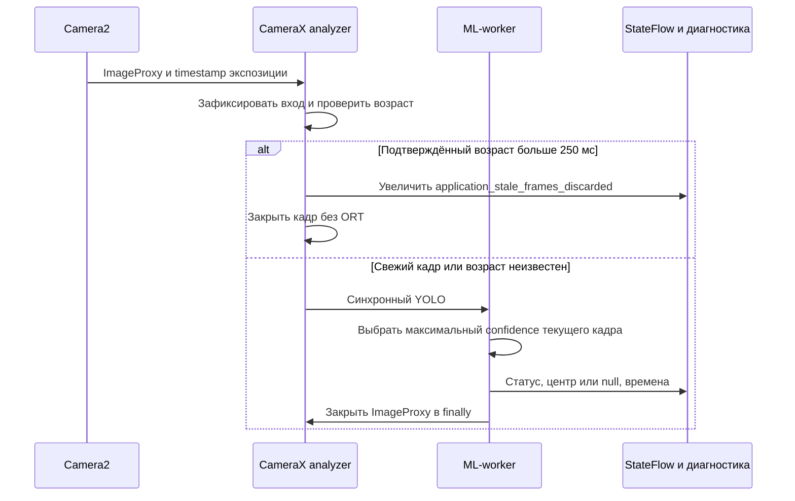

# Задержка экспозиции и координаты текущего кадра

Инструкция разработчику и тестировщику Android 0.5.1. Сигнал — внутреннее событие приложения и диагностический JSON. Подключения внешнего устройства и подтверждения физического действия нет. Каждый кадр анализируется независимо; трекинга и прогнозирования нет.

## Что измеряется

CameraX с Camera2 передаёт `ImageInfo.timestamp`. Для этого источника метка соответствует `SENSOR_TIMESTAMP`: началу экспозиции первой строки активной области сенсора. Это не время экспозиции конкретной строки, в которой находится дрон. Контракт — [CaptureResult.SENSOR_TIMESTAMP](https://developer.android.com/reference/android/hardware/camera2/CaptureResult#SENSOR_TIMESTAMP).

`CameraPreview` проверяет `SENSOR_INFO_TIMESTAMP_SOURCE` выбранной камеры. Только для REALTIME метку разрешено вычитать из `SystemClock.elapsedRealtimeNanos()`. При UNKNOWN сопоставимость с часами приложения не гарантируется. Основание — [источник временных меток Camera2](https://developer.android.com/reference/android/hardware/camera2/CameraCharacteristics#SENSOR_INFO_TIMESTAMP_SOURCE).

| Поле сигнала | Определение |
|---|---|
| `capture_ns` | Метка начала экспозиции камеры в нс, null при отсутствии |
| `analyzer_entry_ns` | elapsedRealtimeNanos при входе в callback analyzer |
| `signal_dispatch_ns` | Чтение elapsedRealtimeNanos после выбора центра, перед построением и синхронной публикацией сигнала |
| `capture_to_analyzer_ms` | `(analyzer_entry_ns - capture_ns) / 1e6`: экспозиция, доставка и ожидание worker |
| `analyzer_to_signal_ms` | `(signal_dispatch_ns - analyzer_entry_ns) / 1e6`: обработка кадра и подготовка результата |
| `capture_to_signal_ms` | `(signal_dispatch_ns - capture_ns) / 1e6`: обе составляющие |

Причины `timing_issue` проверяются по порядку:

1. `unsynchronized_camera_clock` — источник не REALTIME.
2. `missing_capture_timestamp` — метка отсутствует или <=0.
3. `capture_after_analyzer` — метка экспозиции позже входа в analyzer.
4. `non_monotonic_dispatch_clock` — часы публикации раньше входа.

При любой причине обе задержки от экспозиции равны null. Analyzer-to-signal остаётся доступной, если собственные метки приложения упорядочены, даже при UNKNOWN камеры. Смещение часов из времени первого callback не подбирается. Pipeline и стадии сохраняют `System.nanoTime`; из них не вычитаются метки Camera2. Без явно переданного eventTime или FrameStamp контроллер не публикует сигнал; Android-экран передаёт оба.

Конец измерения — готовность сигнала непосредственно перед присваиванием `LiveController.signals: StateFlow<TargetSignal?>`. Чтение часов предшествует сборке небольшого payload и присваиванию; эти затраты отдельно не измерены. Обработка подписчиком, отображение экрана и физическое действие в интервал не входят. Поток conflated: медленный подписчик может пропустить промежуточные значения. JSON сохраняет сигналы обработанных кадров во время активной диагностической сессии в пределах её capacity.



Рисунок 1. Путь кадра до внутреннего сигнала. Generation/source проверки перед публикацией отбрасывают устаревшие результаты после Stop, порога, pause, ошибки и rebind. Дополнительной очереди изображений нет.

До передачи кадра контроллеру CameraPreview закрывает его при ошибке получения/создания метаданных; после передачи кадр закрывается только в finally контроллера. Это исключает удержание ImageProxy до входа в analyze и повторное закрытие после него.

## Координаты одного кадра

Реализация — [TargetSignal.kt](../../app/src/main/java/ru/university/dronecv/camera/TargetSignal.kt). Среди рамок текущего результата YOLO выбирается максимальный confidence; при равенстве — первая рамка в списке. Предыдущие кадры не влияют на выбор. Все зелёные рамки текущего результата сохраняются на экране; жёлтая точка отмечает выбранный центр.

`center.x/y` — непрерывный центр рамки в пикселях upright crop; начало слева сверху, оси вправо и вниз. `width/height` — размеры этой области после поворота. Центр ограничен `[0,W-1] × [0,H-1]`; `pixel.x/y` — индексы через отбрасывание дробной части. Это не координаты полного сенсора и не px скриншота. Для Preview используется та же геометрия, что для рамок; см. [потоки данных](../architecture/data-flow.md).

`frame_id` нумерует опубликованные сигналы в экземпляре контроллера; это не номер кадра сенсора. `source_id` относится к активации analyzer. ID объектов нет. Статус `detected` сопровождается center/pixel/confidence, `no_target` — null во всех трёх полях. Кадр без обнаружений сразу заменяет прежние координаты. Stop/pause/error/rebind/смена порога и UI expiry очищают весь сигнал до null. null в StateFlow означает отсутствие актуального результата, а no_target — обработанный кадр без обнаружения.

## Экспорт и проверка

Корневая диагностика сохраняет schema 1; вложенный сигнал имеет версию 2. Поля, p50/p95 и миграция потребителя v1 описаны в [модели данных](../reference/data-model.md#сигнал-текущего-кадра-payload-v2-в-051). Анализатор читает старые отчёты без сигнала и payload v1, не изменяя исходные файлы.

Сводки задержек включают все доступные измерения, в том числе кадры no_target. Для задержки только обнаружений фильтруйте status=detected. p50 совпадает с median; p95 nearest rank доступен при >=20 измерениях, иначе null. `capture_timing_availability.available_fraction` показывает долю сохранённых кадров с корректной задержкой от экспозиции; для пустого ряда null. UNKNOWN не считается доступной меткой. Устаревшие входы считаются отдельно, CameraX upstream drops остаются неизвестными; усечённые кадры не входят в сводки.

1. На Xiaomi 17 Pro запустить детекцию. Проверить причину null либо «Экспозиция → сигнал», координаты, confidence и размеры при обнаружении. Рамка на произвольной сцене не обязательна. При нескольких дронах центр должен соответствовать рамке с максимальным confidence текущего кадра; при отсутствии рамок координат быть не должно.
2. После прогрева записать диагностическую сессию по [PERFORMANCE_QA](../PERFORMANCE_QA.md). Экспортировать JSON и пересчитать:

```bash
python3 ml/scripts/analyze_android_sessions.py /absolute/path/to/session.json --output /tmp/session-analysis.json
python3 -m unittest discover -s ml/tests -p test_target_signals.py -v
```

3. Проверить пустой список errors, долю доступных меток, p50/p95 и три интервала. Повторить Stop/start, фон, поворот, смену камеры/1×/5×, изменение порога и сцену без дрона; прежние координаты не должны появляться после invalidation.
4. Проверить нагрев, память и длительную работу на реальном телефоне. Unit-тесты с заданными рамками и часами и CI-эмулятор проверяют контракт, но не аппаратную точность timestamp или качество YOLO. Новые измерения Xiaomi 17 Pro для этой сборки не получены.

## Как уменьшать задержку

ORT не запускается для кадров с подтверждённым возрастом больше 250 мс на входе. Это уменьшает бесполезную обработку старых входов, но не ускоряет один вызов ORT. KEEP_ONLY_LATEST и общий последовательный worker сохранены; CameraX upstream drops не вычисляются из числа callback.

Сначала сравнить 1/2/4 потока на целевом телефоне по [протоколу](../ORT_THREAD_BENCHMARK.md), отдельно смотря capture-to-analyzer и analyzer-to-signal. Исторические [измерения Mi 8 Lite](../../ml/results/android/analysis52/REPORT.md) указывали около 96,5% времени pipeline в ORT с копиями; это не измерение текущей сборки или Xiaomi 17 Pro. Меньший размер потока CameraX сам по себе не меняет фиксированный вход модели 640×640. Модель и backend этой задачей не меняются; измеренное ускорение не заявляется.
