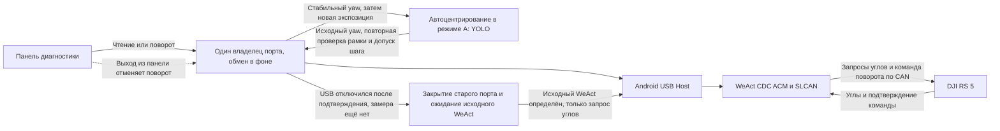

# Чтение углов и ручной поворот DJI RS 5

Отладочная сборка Drone CV читает ориентацию подвеса через Android USB Host и WeAct USB2CANFDV1 с прошивкой SLCAN. Для проверки нужны vivo, USB-кабель с передачей данных или OTG-переходник и адаптер WeAct. Для получения углов нужен включённый DJI RS 5 и проверенный кабель CAN к RSA/NATO. [Профиль соединения на стенде](../../lab/dji_rs_probe/readme.md#проверка-с-подвесом).

## Проверка на телефоне

1. Соберите и установите debug APK по [инструкции установки](../deployment.md). На vivo откройте «Камера», при первом входе разрешите доступ к камере и разверните «Диагностику» рядом с превью. Детекцию и запись журнала можно оставить выключенными.
2. Нажмите **Прочитать углы DJI** без адаптера. Приложение покажет «Адаптер WeAct не найден».
3. Подключите к vivo только WeAct. Если телефон не видит адаптер, найдите переключатель OTG через поиск в настройках vivo и включите его. Нажмите кнопку и отклоните системное разрешение. Убедитесь, что появился статус «Доступ к WeAct не предоставлен».
4. Нажмите кнопку снова и разрешите доступ. Проверьте, что появилась версия прошивки WeAct и один из [статусов обмена](#порядок-обмена). Пока идёт обмен, кнопка недоступна. Переподключите WeAct, нажмите кнопку и выньте USB, пока открыто окно разрешения. Приложение должно показать «Адаптер WeAct отключён».
5. Подключите CAN-кабель к включённому DJI RS 5 и снова подключите WeAct к vivo. Нажмите кнопку и при необходимости разрешите доступ. Проверьте, что видны версия WeAct, yaw, pitch и roll в градусах. Затем вручную измените положение подвеса и сделайте отдельное чтение. Сверьте изменение соответствующей оси.

## Один поворот DJI

С подключённым подвесом нажмите **Один поворот DJI** в той же панели. Приложение считывает исходный yaw, отправляет одну команду относительного поворота на +3° по yaw и ждёт подтверждение DJI. Через 1,25 с после подтверждения приложение повторно считывает yaw. Разность углов учитывает переход через ±180°.

Панель отдельно показывает подтверждение передачи от WeAct, ответ DJI и измеренный поворот. Принятая команда может дать 0,0°. Если WeAct отключился после подтверждения DJI и замера ещё нет, приложение освобождает старый USB-порт. Панель показывает «Ожидаем подключения WeAct…», пока приложение ждёт возвращения адаптера до 10 с. Если Android показывает запрос доступа, панель сообщает «Подтвердите доступ к WeAct в Android»; на ответ отводится до 60 с, это время не расходует ожидание адаптера. После разрешения приложение повторно проверяет подключение и идентичность. Через новый порт приложение отправляет один запрос углов с новым номером и сравнивает ответ с исходным yaw той же попытки. На одно нажатие приходится максимум одна команда движения.

Приложение ищет исходный WeAct по серийному номеру USB, полученному после выдачи доступа. Системное имя `deviceName` может измениться при переподключении. Адаптер, подключённый вместе с исходным в начале попытки, исключается из поиска. [Серийный номер USB в Android](https://developer.android.com/reference/android/hardware/usb/UsbDevice#getSerialNumber()).

Для стенда с одним WeAct без серийного номера предполагается, что оператор возвращает тот же физический адаптер. После зафиксированного отключения исходного порта приложение может продолжить замер с единственным WeAct без номера уже при первом опросе. Если за время попытки приложение увидело несколько WeAct, этот способ восстановления недоступен.

Если исходный адаптер нельзя определить однозначно, срок ожидания истёк или чтение через новый порт сорвалось, панель сохраняет «Команда DJI: Принята», показывает «Не измерен» и выводит причину. На ответ DJI для каждого запроса отводится до 2 с после отправки. Обе кнопки недоступны до завершения попытки и освобождения порта.

Закрытие раздела «Диагностика» или выход с экрана отменяет попытку и ожидание WeAct. Кнопка «Свернуть» только уменьшает высоту панели и обмен не отменяет. Приложение освобождает порт, даже если он открылся после отмены. При возвращении панель показывает подтверждения, полученные до завершения обмена.

### Отдельный прогон с переподключением

1. Считайте углы на подключённом DJI RS 5 и запишите исходный yaw. Нажмите **Один поворот DJI** один раз и отключите USB со стороны телефона, пока поворот ещё выполняется.
2. Подключите тот же WeAct обратно в пределах 10 с. При быстром переподключении сообщение об ожидании может исчезнуть сразу. Убедитесь, что команда отмечена как «Принята». Если Android запрашивает разрешение, предоставьте его в течение 60 с после показа запроса.
3. Запишите показанный поворот и причину сбоя, если замер отсутствует. Сделайте отдельное чтение углов и сверьте разницу с исходным yaw с учётом перехода через ±180°.

## Автоцентрирование DJI на стенде с фотографией

1. Закрепите vivo на DJI, подключите WeAct и проверьте чтение углов из «Диагностики». Так USB-доступ будет выдан до запуска сеанса. Для сбора logcat при подключённом WeAct используйте ADB по Wi-Fi.
2. В «Настройках» выберите **A: YOLO**. Запустите детекцию и дождитесь рамки. Разместите фотографию так, чтобы центр рамки был за пределами ±10% ширины кадра от его середины.
3. Нажмите **Автоцентрирование DJI** рядом с кнопкой детекции. При смещении вправо первый шаг запрашивает +3° yaw, при смещении влево −3°. Направление и уменьшение видимого смещения подтвердите для фактического крепления vivo. Прекратите испытание кнопкой **Стоп автоцентрирования**, если рамка уходит в обратную сторону.
4. В показаниях камеры смещение X и Y вычисляется по центру текущей рамки в процентах ширины и высоты кадра: положительные значения направлены вправо и вниз. Статус «По горизонтали в центре» относится только к оси X. Проверьте отдельно подтверждение DJI, исходный yaw, угол после шага и контрольный угол. Зафиксируйте начальное и итоговое смещения, углы, число шагов и причину завершения. Для замера возраста запишите значения `capture_to_yolo_ms` из `adb logcat -s DjiCentering:I`. Метки `capture_ns`, `required_after_ns` и `completed_ns` позволяют сверить порядок кадров и поворотов.

Первый кадр должен быть снят после нажатия, каждый следующий строго после подтверждённой стабилизации предыдущего шага. Метки экспозиции Camera2 REALTIME и завершения шага используют `elapsedRealtimeNanos`. На свежий кадр отводится 6 с. Предварительный предел возраста результата для статического стенда составляет 2,5 с. Приложение проверяет его при выборе кадра и перед отправкой команды. В предыдущем стендовом прогоне на vivo от экспозиции до результата проходило 1,24–1,58 с. Значения этой сборки измеряются отдельно.

После чтения исходного yaw приложение проверяет последнее наблюдение YOLO под замком публикации с той же границей экспозиции. Свежая рамка в зоне покоя завершает сеанс с `centered`. При смене стороны цикл заново выбирает направление для того же номера шага. Команда уходит, если свежая рамка осталась с выбранной стороны.

За один шаг отправляется одна команда yaw. Примерно через 1,25 с после подтверждения DJI считывается yaw, через 350 мс выполняется контрольное чтение. Шаг завершён, если yaw изменился минимум на 0,5° в требуемую сторону и два последних показания отличаются максимум на 0,2°. После пятого шага свежий кадр определяет, достигнут центр или лимит. Потеря цели, устаревший результат, несопоставимые метки, сбой, остановка детекции или выход из камеры завершают сеанс. «Стоп автоцентрирования» прекращает новые команды и сохраняет известный статус уже отправленной команды.

Автосеанс удерживает исходный USB-порт между шагами. Ручное чтение и ручной поворот доступны после его освобождения. Если WeAct отключился после подтверждения DJI, применяется тот же поиск исходного адаптера и контрольное чтение. Даже при успешном чтении после переподключения сеанс завершён. Отображается измеренный yaw и причина остановки. [Правила выбора адаптера](#один-поворот-dji).

## Порядок обмена

Приложение запрашивает разрешение Android. Открытие CDC ACM и обмен идут в фоне. Первая команда `V` запрашивает версию WeAct. Затем приложение использует классический CAN 1 Мбит/с, TX `0x223`, RX `0x222`. Запрос углов занимает три CAN-кадра, команда поворота четыре.

- «WeAct отклонил передачу CAN» и «Тайм-аут подтверждения передачи CAN от WeAct» различают отказ и отсутствие подтверждения фрагмента. Отдельно показываются истечение ожидания USB-разрешения и истечение ожидания исходного адаптера при переподключении.
- «DJI не ответил» означает, что адаптер подтвердил передачу всех кадров, а ответ DJI на этот запрос не пришёл за 2 секунды.

В обоих случаях приложение показывает уже прочитанную версию WeAct. Следующее чтение требует нового нажатия.

По завершении или при отмене обмена приложение пытается отправить команду `C`, если CAN-канал мог открыться. На закрытие отведено до 2 секунд. Приложение освобождает USB-соединение и при ошибке команды `C`.

Android и утилита Mac собирают протокол из [общих исходников Kotlin](../../lab/dji_rs_probe/src/shared/kotlin). Android-адаптер распознаёт идентификаторы и строки устройства из [исходников прошивки WeAct](https://github.com/WeActStudio/WeActStudio.USB2CANFDV1.SLCAN_Firmware/blob/master/Source/USB_Device/App/usbd_desc.c) и использует [Android USB Host](https://developer.android.com/develop/connectivity/usb/host).

Подставной порт проверяет логику от нажатия до результата. Аппаратная проверка включает обнаружение WeAct, выдачу USB-разрешения, получение версии, обмен кадрами с подвесом и сверку измеренного yaw после поворота. [Команды автоматических проверок](../development/testing.md#чтение-углов-dji-через-usb).
