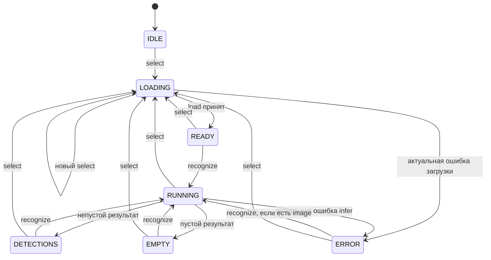
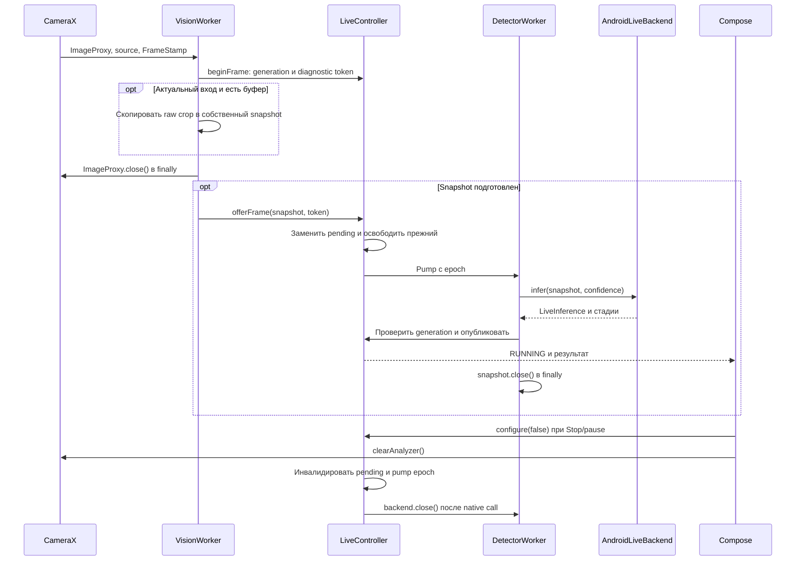
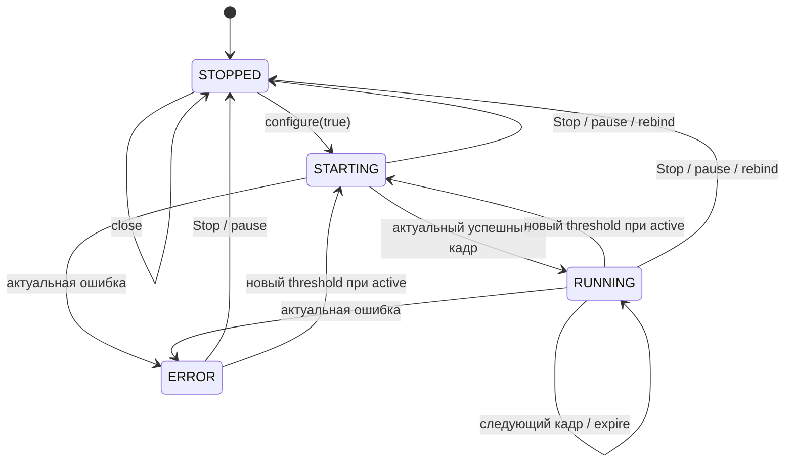
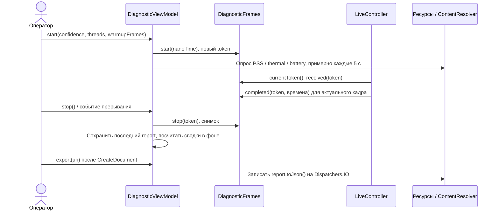

# Детекция и жизненный цикл

Описание для разработчика, меняющего обработку фото, камеры или диагностики. Применяется к текущим контроллерам; координаты и границы измерений вынесены в [потоки данных](../architecture/data-flow.md).

## Содержание

- [Выбор и распознавание фото](#выбор-и-распознавание-фото)
- [Кадры живой камеры](#кадры-живой-камеры)
- [Потоки ORT и камеры](#потоки-ort-и-камеры)
- [Диагностическая сессия](#диагностическая-сессия)
- [Ошибки и инварианты](#ошибки-и-инварианты)

## Выбор и распознавание фото

Сценарий запускается из [PhotoScreen](../../app/src/main/java/ru/university/dronecv/photo/PhotoScreen.kt). Photo Picker возвращает URI только выбранного изображения; отмена не вызывает `select()` и сохраняет состояние. Точка входа — `PhotoViewModel.select(String)`, после загрузки пользователь вызывает `recognize()`.

```mermaid
sequenceDiagram
    actor U as Пользователь
    participant UI as PhotoScreen / ViewModel
    participant C as PhotoController
    participant W as DetectorWorker
    participant B as AndroidPhotoBackend
    participant E as OnnxDroneDetector
    U->>UI: Выбрать фото (URI)
    UI->>C: select(uri)
    C-->>UI: LOADING, новая generation
    C->>W: Команда Load (conflated channel)
    W->>B: load(uri)
    B-->>C: Upright Bitmap
    alt Запрос актуален
        C-->>UI: READY с изображением
    else Выбрано другое фото / close
        C->>B: discard(неопубликованный bitmap)
    end
    U->>UI: Распознать
    UI->>C: recognize()
    C-->>UI: RUNNING
    C->>W: Команда Infer
    W->>B: infer(тот же bitmap)
    B->>E: create при необходимости; detectDetailed(bitmap, 0)
    E-->>B: YoloResult
    B-->>C: PhotoInference
    C-->>UI: DETECTIONS / EMPTY, если generation актуальна
```

Рисунок 3. Обработка фото. Стрелки к worker обозначают исполнение команд; контроллер не прерывает начавшийся нативный вызов. Ошибки публикуются только для текущей generation.

[PhotoController](../../app/src/main/java/ru/university/dronecv/photo/PhotoController.kt) имеет одну выполняемую и одну ожидающую команду (`Channel.CONFLATED`). Новая ожидающая команда заменяет прежнюю. `select()` увеличивает generation, снимает старое фото/результат из состояния и ставит загрузку. `recognize()` доступен при наличии изображения и отсутствии текущего `RUNNING`; результат/ошибка прошлого запроса не могут заменить новое фото.

[AndroidPhotoBackend](../../app/src/main/java/ru/university/dronecv/photo/AndroidPhotoBackend.kt) читает URI через `ContentResolver`. На API 28+ использует software `ImageDecoder`, на API 26/27 — bounds pass, subsampling и матрицу всех восьми EXIF-ориентаций. Кадр ограничен по размеру, приведён к sRGB/ARGB; прозрачность наложена на чёрный фон. В инференс передаётся тот же upright bitmap, который рисует UI.



Рисунок 4. `PhotoPhase`. `close()` из любой фазы очищает состояние до IDLE и закрывает контроллер для новых запросов; отдельной фазы CLOSED в enum нет. Ошибка загрузки оставляет состояние без изображения, ошибка infer сохраняет его для повтора.

Activity-scoped [PhotoViewModel](../../app/src/main/java/ru/university/dronecv/photo/PhotoViewModel.kt) удерживает фото и результат при ротации/переключении вкладок. `onCleared()` вызывает неблокирующий `close()`: generation инвалидируется, канал/scope отменяются, `backend.close()` выполняется в `finally` worker после окончания нативного вызова. Опубликованный Compose bitmap не recycle-ится вручную; его освобождает GC после снятия ссылок. Явный `discard()` допустим только для изображения, которое не публиковалось.

## Кадры живой камеры

Сценарий начинается после выдачи разрешения в [CameraScreen](../../app/src/main/java/ru/university/dronecv/camera/CameraScreen.kt), успешной привязки, `RESUMED`, потока превью и пользовательского запуска. [CameraPreview](../../app/src/main/java/ru/university/dronecv/camera/CameraPreview.kt) создаёт Preview/ImageAnalysis в одном `UseCaseGroup` с ViewPort от PreviewView. Анализ предпочитает 640×480 с fallback; реальный размер выбирает CameraX.



Рисунок 5. Вход камеры независим от инференса. Только собственные snapshot пересекают границу исполнителей; ошибка проходит через generation, освобождение снимка и упорядоченный release.

CameraX сохраняет RGBA/KEEP_ONLY_LATEST. VisionWorker копирует и закрывает ImageProxy; LiveController держит один pending snapshot, а DetectorWorker сериализует нативную обработку. Конвертер copyInto не сохраняет leased-массив; заимствованный convert не передаётся асинхронно. [Полный контракт](../guides/camera-frame-ingress.md).

Защита результатов имеет разные назначения:

| Механизм | Что предотвращает |
|---|---|
| `generation` | Публикацию результата/ошибки до Stop, смены порога или другой invalidation |
| `pumpEpoch` | Получение новым кадром места старой ML-задачи перед release прежней активации |
| `source` | Приём callback старой активации analyzer, даже на прежнем binding |
| `activationEpoch` в Preview | Повторное использование analyzer после pause/resume, слитых до recomposition |
| `revision` | Удаление нового результата старым таймером UI expiry |
| `selectionEpoch` камеры | Применение старых callback bind/zoom/metadata к новому выбору камеры |



Рисунок 6. `LivePhase`. `ERROR` блокирует новые infer до повторной активации. Смена порога при активной детекции также переводит контроллер в STARTING. `expire(revision)` очищает рамки и текущие времена без смены RUNNING; UI вызывает его через 1500 мс без нового результата. `close()` из любой фазы публикует STOPPED, запрещает дальнейшую работу и ставит освобождение backend в очередь.

Stop снимает analyzer и сохраняет превью. Pause/пропажа streaming/resize/display rotation инвалидируют результат сразу; новая активация получает новый source. Возврат из фона/ротация восстанавливают включённый режим, а после смены вкладки запуск ручной. Панель управления имеет размер относительно окна, прокручивается внутри и не меняет ViewPort при появлении статистики. UI результата собирает StateFlow на `Dispatchers.Main.immediate`.

## Потоки ORT и камеры

`LiveController.requestThreads(1|2|4)` принимает смену только при остановленной детекции, без кадра в работе, активной диагностики и предыдущего переключения. Возвращаемое `true` означает принятие запроса, а не успешное создание сессии; итог находится в `threadConfiguration`.

[ThreadSessionManager](../../app/src/main/java/ru/university/dronecv/detection/onnx/ThreadSessionManager.kt) закрывает старую сессию до открытия новой. Если создание не удалось, пытается восстановить прежнюю; ошибка восстановления добавляется как suppressed. Если закрытие не удалось, новая сессия не открывается. Фото сохраняет собственный детектор с параметрами по умолчанию.

Выбор 1×/5× или физического ID меняет `selectionEpoch`, прерывает диагностику и перепривязывает обе camera use cases. 5× проверяется по доступному zoom range. При отказе нестандартного выбора выполняется попытка возврата к 1×/auto; ошибка исходной конфигурации выводится на экран. ID и zoomRatio отражают доступные API сведения, без гарантии оптического объектива; проверка — [CAMERA_QA](../CAMERA_QA.md).

## Диагностическая сессия

Назначение — собрать измерения реального analyzer без записи изображений. Точка входа — `DiagnosticPanel` → `DiagnosticViewModel.start(confidence, threads, warmupFrames)`, доступная после кадра RUNNING. Число прогревочных кадров передаётся в отчёт; автоматического прогрева/таймера окончания нет.



Рисунок 7. Запись и экспорт диагностики. Сессионный token исключает завершение старого кадра в новом отчёте. Опрос ресурсов выполняется независимой coroutine и не подразумевает пробу на каждый кадр.

Фон, выключение экрана, смена вкладки/порога/камеры, rebind, Stop или ошибка прерывают сессию с причиной. После возврата запись автоматически не продолжается. Последний отчёт остаётся в Activity ViewModel до новой сессии/уничтожения процесса; экспорт нужен до этого. Порядок измерений задан в [PERFORMANCE_QA](../PERFORMANCE_QA.md), данные — в [справочнике](../reference/data-model.md).

## Ошибки и инварианты

После YOLO DetectorWorker выбирает максимальный confidence отобранного snapshot и публикует signals/LiveState.target только при актуальной generation. Входные ImageProxy независимо копируются/закрываются на VisionWorker; latest-only очередь снимков и владение описаны в [контракте входа](../guides/camera-frame-ingress.md). Кадр без обнаружений публикует NO_TARGET с null-координатами. Configure/Stop/error/rebind инвалидируют pending и epoch pump; expire очищает UI-сигнал. Синхронное повторное управление подписчиком не должно возвращать старый результат.

`PhotoError` различает доступ, изображение, память, отсутствие/целостность модели и прочую ошибку infer. Пустые детекции — успешный результат EMPTY. В камере recoverable `CameraState` показывает занятость/переподключение, critical ведёт к recovery/error; после ошибки модели рекомендуется Stop/start. Экспорт показывает статус ошибки без фиктивного успешного сохранения. Логи и восстановление описаны в [runbook](../operations/runbook.md).

Не ждите закрытия ORT на UI и не вызывайте shutdownNow общих workers. ImageProxy не передаётся другому исполнителю: только собственный snapshot с generation/source/diagnostic token. Заимствованные массивы и опубликованные Bitmap нельзя освобождать до завершения читателя. Infer, смена потоков и close остаются на общем ML-worker; [тестирование](../development/testing.md).
